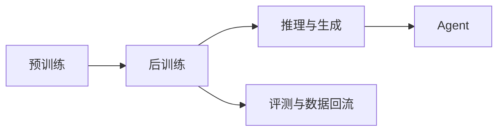

这个板块不是「LLM 入门」，而是**按岗位方向整理的知识地图**：每个方向在解决什么问题、需要哪些概念、按什么顺序学、面试会问什么。

三条主线对应三类岗位，但它们共享同一套底座：

- **后训练**：SFT、偏好学习、RL，三条主线的公共底座
- **推理与生成**：Reasoning、Math、Code
- **Agent**：Tool Use、长程任务
- 评测结果会回流成下一轮后训练的数据（这条线画出来会让图变乱，所以写在图外）

🧠 三个方向

- [强化学习](rl/index.md) 用奖励信号把「会」变成「稳定地对」：RLHF / RLVR / PPO / GRPO
- [后训练](post-training/index.md) 预训练之后的一切：能力提升、数据、奖励、评测
- [Code Agent](code-agent/index.md) 让模型进入真实仓库，完成多步、长程的软件工程任务

## 为什么按方向组织

同一个概念在不同方向里的重要性完全不同。比如 PPO，在强化学习方向是必须能手推的，在后训练方向只要知道它在流程里的位置，在 Code Agent 方向更多是「知道什么时候该用它」。

所以每个方向页都按同一个结构写：

1. **在解决什么问题** —— 一句话说清楚这个岗位的价值
2. **概念地图** —— 术语表，每条一句话，知道「是什么」和「为什么重要」
3. **学习路径** —— 先学什么，再学什么
4. **面试常问** —— 真实会被问到的问题
5. **阅读清单** —— 值得读的论文和项目

## 共同底座

不管走哪个方向，下面这些是绕不开的：

- **Transformer 与注意力**：手撕级别，见[手撕代码 · Attention](../llm-coding/attention.md)
- **训练与推理的基础**：显存、并行、混合精度、KV Cache
- **评测**：benchmark 怎么选、污染怎么防、提升是不是真的
- **工程能力**：Python + PyTorch，能改训练脚本、能读别人的仓库

## 建议的顺序

1. 先读三个方向页的「在解决什么问题」，判断自己想去哪
2. 按那个方向的学习路径走，遇到不熟的术语再回概念地图查
3. 手撕题单独练：那个板块里的题是面试现场要写的

!!! tip "怎么用这份地图"

    不要从头到尾顺着读。先选方向，再看概念地图里哪些词你没听过——**没听过的就是你要补的**。每补一个，回到对应方向页把那条笔记写完整。
